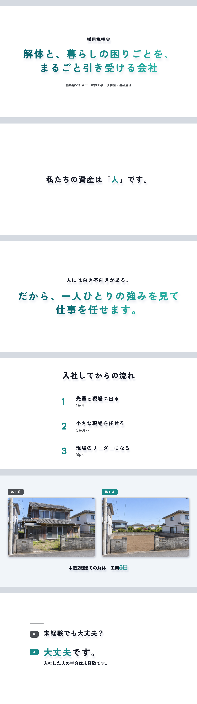

# 原稿を貼るだけで、会社案内や採用説明のスライドが組める、AIの手順書（スキル）

下の画像のようなスライドが、文章を貼るだけで出来上がります（中身は見本で、仮の内容です）。

プロのデザイナーが、セミナー資料と営業資料あわせて250枚あまりを組んで、実物を測って決めた資料づくりの決まりを、AIに読ませる形にしました。

- 1枚に伝えたいことは1つ。強調する言葉も1つだけ
- 字の大きさ・色・余白・句読点の詰めまで、全部の枚でそろう
- 原稿の中身に合わせて、表紙・手順・施工前と施工後・料金・よくある質問など、19の組み方から選ぶ

## いちばん簡単な使い方（3分・無料のAIでも使えます）

1. [貼り付け用.txt](貼り付け用.txt) を開き、全文をコピーします
2. Claude（claude.ai）か ChatGPT の新しいチャットに貼り付けて送ります
3. 「何の資料か」と「原稿」を聞かれるので、答えます

Claude なら、出来たスライドがそのまま画面の横に表示されます。
ChatGPT で文字（`<html>` から始まる文）が返ってきた時は、メモ帳に貼って「スライド.html」の名前で保存し、ダブルクリックで開きます。
ブラウザの「印刷」→「PDFに保存」で、1枚1ページの PDF になります。

## スキルとして登録する方法（使い慣れている方向け）

### Claude（claude.ai）
1. このリンクを押すと、スキルのファイル（slide-design.zip）が保存されます：[slide-design.zip をダウンロード](https://github.com/takeuchitsubasa-ops/slide-design-skill/raw/main/slide-design.zip)
2. claude.ai の「設定」→「機能」→「スキル」で「アップロード」を押し、保存した zip を選びます
3. 新しいチャットで「この原稿でスライドを作って」と原稿を貼ります

※「スキル」の欄が見当たらない時は、上の「いちばん簡単な使い方」で使えます。

### Claude Code
`skills/slide-design` のフォルダを、`~/.claude/skills/` の中にコピーします。

## 出来上がった物
- ブラウザで開ける HTML で出てきます。ブラウザの「印刷」→「PDFに保存」で、1枚1ページの PDF になります
- 写真の場所には仮の箱が入ります。写真を渡せば、切らずに収めて入れます

---
作った人：竹内翼（AIの導入支援・コンサルティング）
